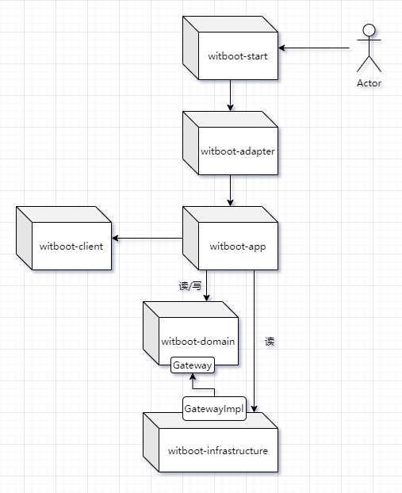
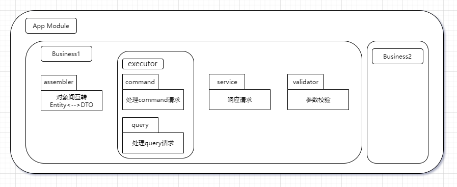
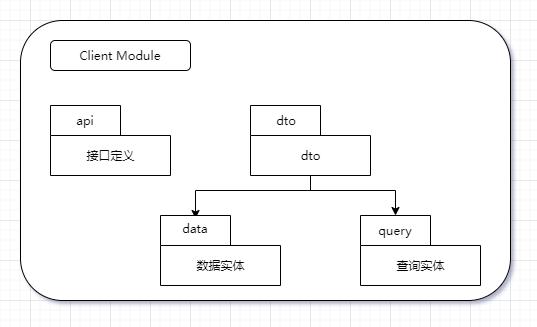
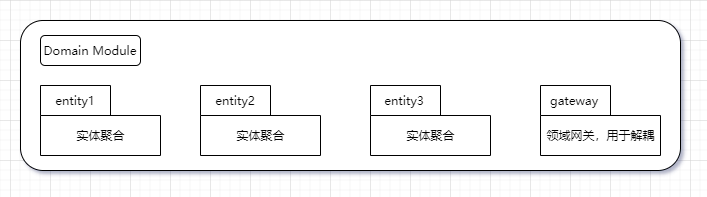
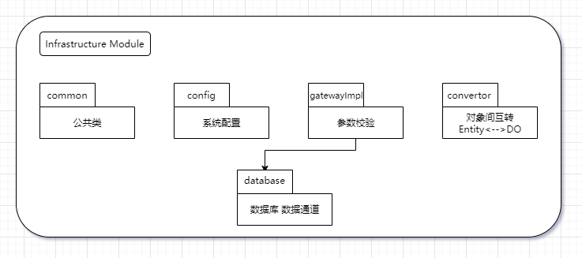

# WitBoot

> 本项目结合Spring Boot3.4.4和COLA 5.0.0（整洁面向对象分层架构）实现。

项目工程与 Agent 协作规范统一维护于 [AGENTS.md](AGENTS.md)。

系统功能、设计草案与交付状态见 [OpenSpec 需求与设计台账](openspec/requirements.md)。开发与验收步骤见 [需求管理流程](openspec/需求管理.md)。

## 项目架构图

## 组件构成
* **witboot-start**：
* **witboot-adapter**：
* **witboot-app**：
* **witboot-client**：
* **witboot-domain**：
* **witboot-infrastructure**：

## 模块规范

## 特性
* 数据比对器，简化数据对比
* 路由守卫

## 开发规范

### 方法名约定
| CRUD操作   | 方法名约定                                       |
|----------|---------------------------------------------|
| 新增       | insert                                      |
| 删除       | remove（App和Domain层），delete（Infrastructure层） |
| 修改       | update                                      |
| 查询（单个结果） | get                                         |
| 查询（多个结果） | list                                        |
| 分页查询     | page                                        |
| 统计       | count                                       |
| xxx参数查询     | xxxParamQuery                                  |

### 命名规范
|规范|用途|解释|
|---|---|---|
|xxxCO| Client Object | 客户对象，用于传输数据，等同于DTO |
|xxxCmd| Client Request | Cmd代表Command，表示一个写请求 |
|xxxQuery| Client Request | Query，表示一个读请求 |
|xxxCmdExe| Command Executor | 命令模式，每一个写请求对应一个执行器 |
|xxxQueryExe| Query Executor | 命令模式，每一个读请求对应一个执行器 |
|xxxVO| Value Object | 值对象 |
|xxxEntity| Entity | 领域实体 |
|xxxDO| Data Object | 数据对象，用于持久化 |
|xxxInterceptor| Command Interceptor | 拦截器，用于处理切面逻辑 |
|IxxxService| API Service | xxxServiceI |
|xxxDomainService| Domain Service | 需要多个领域对象协作时，使用DomainService |
|xxxValidator| Validator | 校验器，用于校验的类 |
|xxxAssembler| Assembler | 组装器，DTO <---> Entity，用于Application层 |
|xxxConvertor| Convertor | 转化器，Entity <---> DO，用于Infrastructure层 |

### 公众号

